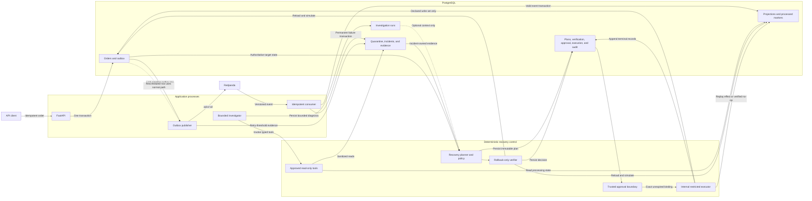
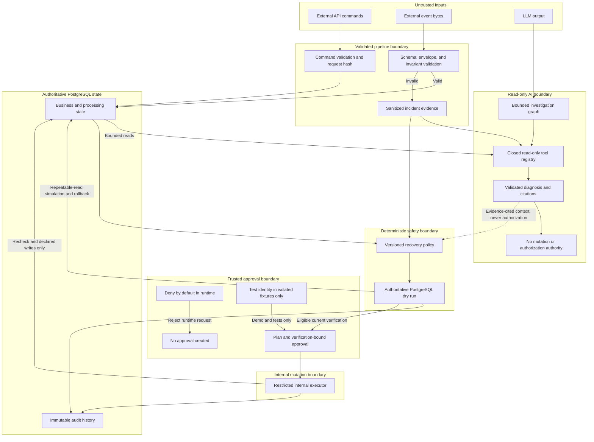
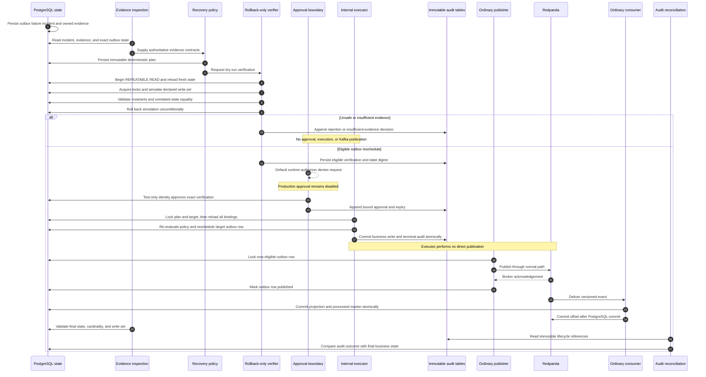

# Architecture and trust-boundary diagrams

These diagrams describe the implemented local architecture. They separate optional AI diagnosis
from deterministic recovery authority and do not imply production recovery availability.

## Component architecture

The executor never publishes directly to Redpanda. `RESCHEDULE_OUTBOX_EVENT` changes only eligible
outbox scheduling fields; the ordinary publisher remains responsible for broker acknowledgement.

## Trust boundaries

Model output is untrusted input. Pydantic validation and citation checks can make a diagnosis
well-formed and evidence-grounded, but only deterministic policy, fresh PostgreSQL verification,
and trusted approval can authorize a mutating action. The shipped runtime authorizers deny approval
and execution because no production identity provider is configured.

## Recovery sequence

This sequence follows the hosted demo's eligible outbox-rescheduling lane. The demo uses
deterministic evidence inspection and makes no LLM request.

For `REPLAY_VERIFIED_EVENT`, the executor uses the shared consumer application logic with exact
authoritative bytes. Unsupported, malformed, poison, invariant-invalid, stale, or foreign-evidence
plans take the rejection branch and cannot reach approval or mutation.
